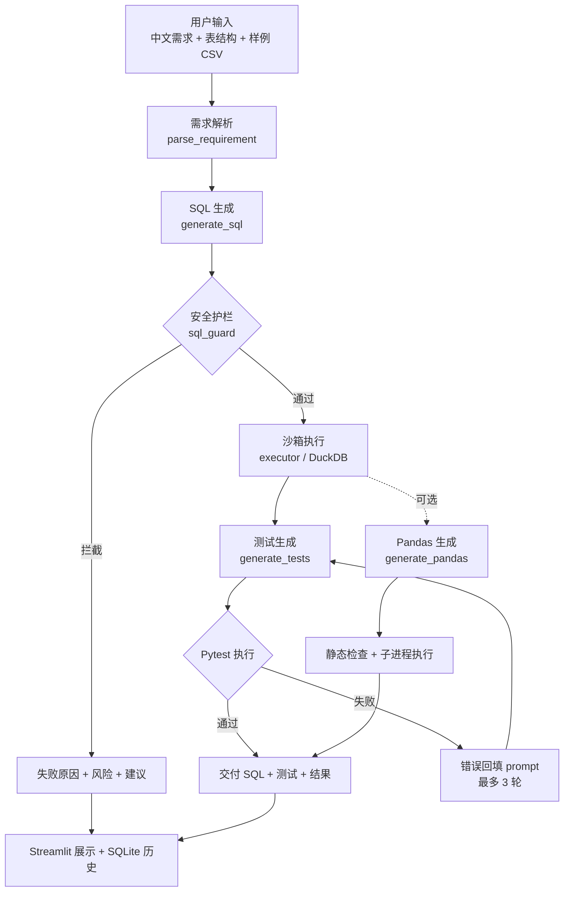
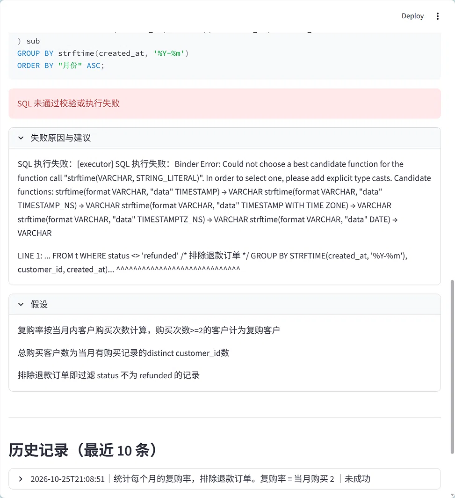

# zh-data-codegen


面向中文业务场景的「数据处理代码生成 + 自动测试」小工具：输入中文需求、单表结构和少量样例数据，输出可执行的 DuckDB SQL / Pandas 脚本，并自动生成、自动执行 pytest 测试。

## 核心特性

- **中文需求直接可用**：中文业务需求 → DuckDB SQL / Pandas 脚本，支持中文列名。
- **内置安全护栏**：只读校验、拦截 DDL / DML、自动为中文列名与中文别名补双引号，避免 DuckDB 绑定错误。
- **核心差异化：测试是一等公民**：自动生成 pytest 用例并自动执行验证；失败时把错误回填 prompt 纠错（最多 3 轮）。
- **本地沙箱执行**：DuckDB 内存库 + 子进程隔离 + 超时保护，不连接真实数据库。
- **过程透明**：假设、风险、待确认问题显式展示。
- **开箱即用**：Streamlit 单页 + SQLite 历史记录。

## 工作流架构



## 快速开始

```bash
# 1. 克隆项目
git clone https://github.com/kang-28-zh/zh-data-codegen.git
cd zh-data-codegen

# 2. 创建环境并安装依赖
conda create -n zh-data-codegen python=3.12 -y
conda activate zh-data-codegen
pip install -r requirements.txt

# 3. 配置环境变量（Windows 用 set，Linux/macOS 用 export）
export OPENAI_API_KEY=sk-xxx
# 可选：export OPENAI_BASE_URL=https://api.deepseek.com/v1
# 可选：export MODEL_NAME=deepseek-chat

# 4. 启动
streamlit run app.py
```

未配置 `OPENAI_API_KEY` 时页面仍可启动，点击生成会明确提示缺少密钥，不会白屏。

运行测试：

```bash
pytest tests/ -v
```

## 示例截图

> 截图占位：请在本地新建 `docs/images/` 目录，把下面三张截图放进去即可自动显示。
>
> ```bash
> mkdir -p docs/images
> # 放入 fail.png / pass.png / history.png
> ```

| 场景 | 截图 |
|---|---|
| 护栏拦截错误 SQL（Binder Error / 类型绑定失败） |  |
| 自动测试通过（pytest 全绿） |  |
| 历史记录（最近 10 条） |  |

## 示例案例

`examples/` 下每个案例包含 `requirement.txt` / `schema.txt` / `sample.csv` / `expected.md`：

| 案例 | 场景 | 数据类型 |
|---|---|---|
| demand_001 | 每月复购率（排除退款） | 单表，英文字段 |
| demand_002 | 每个销售每月成交额环比 | 单表，英文字段 |
| demand_003 | 按月按产品统计退款率 | 单表，中文字段 |
| demand_004 | 合并来源并去重 | 单表，中文字段（Pandas 场景） |
| demand_005 | 新老客划分（首次购买时间） | 单表，中文字段（窗口函数） |

## 项目结构

```
zh-data-codegen/
  app.py                  # Streamlit 单页入口
  core/
    config.py             # 环境变量配置
    models.py             # pydantic 数据结构
    schema_parser.py      # 单表结构解析
    requirement_parser.py # 中文需求解析
    sql_generator.py      # SQL 生成 + 护栏 + 执行
    pandas_generator.py   # Pandas 生成 + 静态检查 + 执行
    test_generator.py     # pytest 自动生成 + 重试
    executor.py           # SQL / Pandas / pytest 沙箱执行
    sql_guard.py          # 只读安全校验
    storage.py            # SQLite 历史记录
    utils.py              # 代码块围栏剥离
  examples/               # 5 个单表示例案例
  tests/                  # 112 个测试
  docs/images/            # 截图（本地放置）
  storage/                # history.db
  requirements.txt
  README.md
```

<details>
<summary>历史记录表结构</summary>

```sql
CREATE TABLE IF NOT EXISTS runs (
    id INTEGER PRIMARY KEY AUTOINCREMENT,
    created_at TEXT NOT NULL,
    requirement TEXT NOT NULL,
    schema_text TEXT NOT NULL,
    sample_csv TEXT NOT NULL,
    sql_success INTEGER,
    sql_text TEXT,
    sql_risks TEXT,
    pandas_success INTEGER,
    pandas_text TEXT,
    pandas_risks TEXT,
    tests_status TEXT,
    tests_content TEXT
)
```

`sql_success` / `pandas_success` 用 0/1；`*_risks` 存 JSON 数组字符串；只 INSERT 与最近 10 条 SELECT。

</details>

## 已知限制

- MVP 仅支持单表分析，多表 JOIN 留待 v2。
- Pandas 执行只做基础防护（危险字符串拦截 + 超时 + 临时目录隔离），不是安全沙箱。
- 中文列名在 DuckDB SQL 中必须加双引号；`sql_guard` 会自动补，直接调用 executor 时需自行保证。
- 受限沙箱环境中 `mkdtemp` 目录可能不可写或留下不可删空目录，正常 Windows/Linux 不出现。

## 手工冒烟记录

首次手工冒烟已完成（2026-10-25，未配置真实 Key，用 mock / 真实接口跑了一次需求）。

- 工具成功拦截了模型生成的错误 SQL：DuckDB 返回 **Binder Error**——日期字段是 `VARCHAR` 未显式转成 `DATE`，且 `GROUP BY` 逻辑有误。
- 页面正确展示了红色报错框、具体失败原因，以及模型对需求理解正确的假设。
- 本次运行的历史记录成功写入 `storage/history.db`。

**结论：工具成功拦截了 AI 生成的错误 SQL，证明了护栏与自动测试机制的价值。**

## v2 待办

- 多表 JOIN 与多表 schema 解析。
- 规则化需求分类（自动判断 SQL / Pandas）。
- 历史记录详情页与删除能力。
- 更细的模型配置与超时策略。
- 前端组件拆分（`ui/` 目录）。

### 已完成

- ✅ v0.1.1：prompt 强制日期/时间字段显式类型转换（如 `CAST AS DATE`）。
- ✅ v0.1.2：`sql_guard` 自动为中文别名加双引号。

## License

MIT License

Copyright (c) 2026 kang-28-zh

Permission is hereby granted, free of charge, to any person obtaining a copy
of this software and associated documentation files (the "Software"), to deal
in the Software without restriction, including without limitation the rights
to use, copy, modify, merge, publish, distribute, sublicense, and/or sell
copies of the Software, and to permit persons to whom the Software is
furnished to do so, subject to the following conditions:

The above copyright notice and this permission notice shall be included in all
copies or substantial portions of the Software.

THE SOFTWARE IS PROVIDED "AS IS", WITHOUT WARRANTY OF ANY KIND, EXPRESS OR
IMPLIED, INCLUDING BUT NOT LIMITED TO THE WARRANTIES OF MERCHANTABILITY,
FITNESS FOR A PARTICULAR PURPOSE AND NONINFRINGEMENT. IN NO EVENT SHALL THE
AUTHORS OR COPYRIGHT HOLDERS BE LIABLE FOR ANY CLAIM, DAMAGES OR OTHER
LIABILITY, WHETHER IN AN ACTION OF CONTRACT, TORT OR OTHERWISE, ARISING FROM,
OUT OF OR IN CONNECTION WITH THE SOFTWARE OR THE USE OR OTHER DEALINGS IN THE
SOFTWARE.
